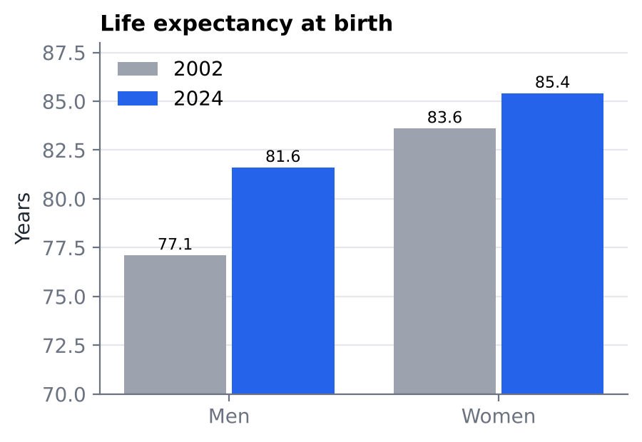
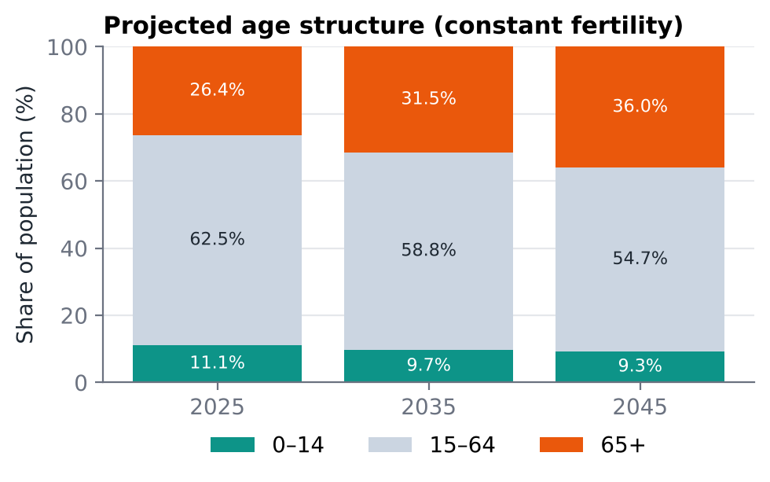

# Demographic Analysis of Mantua (2002–2024)

**22 years of municipal data · growth driven only by migration · population projected to fall 19% by 2045**

📄 [English summary (2 pages)](mantua_summary_EN.pdf) · full report in Italian: [`analisi_demografica_mantova.pdf`](analisi_demografica_mantova.pdf)

## Research question

Mantua has stayed close to 50,000 inhabitants for two decades. What lies behind this apparent stability — how have age structure, mortality, fertility and migration changed since 2002, and what do they imply for the next twenty years? The analysis is written to be understandable also by readers without a background in demography.

## Data

- **Content:** municipal demographic statistics for Mantua, 2002–2024 — resident population by single year of age and sex, births, deaths, and internal and international migration.
- All data and calculations are in [`studio_popolazione.xlsx`](studio_popolazione.xlsx), one sheet per topic: population, age structure, mortality, fertility, migration, projections.

## Methods

1. **Population dynamics:** natural and migration balance, absolute and average annual change, continuous growth rate, doubling time.
2. **Age structure:** population pyramids (2002 vs 2024); old-age, dependency, replacement and structure indices; sex ratio at birth.
3. **Mortality:** crude death rate, age-specific mortality rates, life tables (survivors lx, life expectancy at birth and at 65).
4. **Fertility:** age-specific fertility rates, total fertility rate, mean age of mothers at birth.
5. **Projections:** population by age and sex to 2025, 2035 and 2045 under constant fertility (TFR 1.16).

## Key results

**1. Growth comes entirely from migration.** Deaths exceed births almost every year (−498 in 2020), but net migration has been positive since 2008 and reached +1,002 in 2024. While Italy has been shrinking since 2014, Mantua has kept growing.

**2. People live longer and have fewer children.** Life expectancy at birth rose from 77.1 to 81.6 years for men and from 83.6 to 85.4 for women; the total fertility rate peaked at 1.61 in 2010 and fell to 1.16.

**3. Strong ageing ahead.** Under constant fertility the population falls from about 49,700 to 40,200 by 2045; residents aged 65+ rise from 26% to 36% and the working-age share drops from 62.5% to 54.7%.

**Limitations.** Projections assume that current fertility, mortality and migration patterns stay unchanged; small annual counts make some single-year rates volatile.

## How to reproduce

1. Download the repository (green **Code** button → *Download ZIP*) or clone it with git.
2. Open `studio_popolazione.xlsx` in Excel, LibreOffice or Numbers. Every indicator is a live formula on the source data, so changing an input updates the results and charts.

## Repository contents

| File | Description |
|---|---|
| `studio_popolazione.xlsx` | Source data, all calculations (formulas) and charts |
| `studio_popolazione.pdf` | Printable version of the tables and charts |
| `mantua_summary_EN.pdf` | 2-page summary in English |
| `analisi_demografica_mantova.pdf` | Full report (Italian) |
| `figures/` | Charts used in this README |

**Tools:** Excel

**Author:** Sofia Menegozzo — BSc Statistics and Information Management, University of Milano-Bicocca
